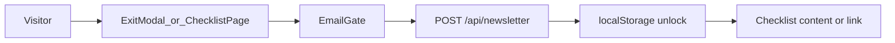

# Engagement conversion pass (1A + gate-then-unlock)

## Scope locked
- **In:** checklist email gate (modal + resource page), thinner homepage, context-aware sticky CTA, clearer operator voice on package/exit CTAs
- **Out:** analytics, `/questions`, events overhaul, Bangla, syllabus gating, WhatsApp message deep-links beyond copy tweaks if sticky covers intent

## 1. Gate then unlock the ERP checklist

Reuse existing lead capture ([`src/lib/leads.ts`](src/lib/leads.ts), [`src/app/api/newsletter/route.ts`](src/app/api/newsletter/route.ts), [`src/lib/utm.ts`](src/lib/utm.ts)).

**API**
- Extend newsletter (or add thin `/api/resource-unlock`) payload with optional `asset` (e.g. `erp-checklist`) so unlocks are distinguishable in `.data/leads.jsonl` while still `lead_type: "newsletter"`.
- Keep honeypot + UTM/`source_path` fields.

**Shared client gate** — new [`src/components/resource-email-gate.tsx`](src/components/resource-email-gate.tsx)
- Email form → POST → on success set `localStorage` key `obd_unlocked_erp-checklist_v1` and reveal children / CTA.
- If already unlocked, skip form.
- Include honeypot + attribution from `utm.ts`.

**Exit-intent** — [`src/components/exit-intent-lead-modal.tsx`](src/components/exit-intent-lead-modal.tsx)
- Replace bare “Get the checklist” link with the email gate.
- On success: show unlocked link to `/resources/erp-checklist` (and optional “Request consultation” secondary).
- Keep dismiss storage key and a11y behavior.

**Resource page** — [`src/components/doc-page.tsx`](src/components/doc-page.tsx)
- When `doc.collection === "resources" && doc.slug === "erp-checklist"`, wrap the prose body in `ResourceEmailGate` so description/title stay visible; body + related stay behind unlock (or show a short teaser + unlock, then full MDX). Prefer: title/description visible; MDX body gated.

## 2. Thin the homepage

Edit [`src/app/page.tsx`](src/app/page.tsx) only (presentation/composition; same destinations).

**Keep (in order)**
1. `LandingHero`
2. One journey: `ProcessDiagram` (“How knowledge flows”)
3. `AudienceSwitcher` (“Paths by audience”)
4. Newsletter + short community principles (single panel)
5. `PackageCta`

**Remove from home (still reachable via nav / learning-center)**
- `LiveCoverage` dashboard
- `PortalIndex` “What this portal covers”
- `CompareMatrix` shortlist block
- “Popular Odoo pages” `LinkTiles`

Drop unused imports after the cut. Preserve `ScrollReveal` / atmosphere wrappers only where sections remain.

## 3. Context-aware sticky CTA

Update [`src/components/sticky-cta.tsx`](src/components/sticky-cta.tsx) to read `pathname` (`usePathname`) and map intent:

| Path prefix | Copy | Href |
|-------------|------|------|
| `/training`, `/odoo-career-guide`, `/developer-resources` | Training advice | `/contact?interest=functional-training` or technical when under `/training/technical` |
| `/comparisons`, `/pricing-guide`, `/packages`, cost landings | Talk to a specialist | `/contact?interest=talk-to-specialist` |
| `/resources`, `/implementation-guide`, `/modules`, `/industries` | Free assessment | `/contact?interest=erp-assessment` |
| default / home | Need Odoo guidance? | `/contact` |

Keep show/hide rules (past hero, hide near footer/keyboard). Mobile-only unchanged.

## 4. Clarify community vs Binary Quest voice

Small copy/layout tweaks only (no route/API changes):

- [`src/components/package-cta.tsx`](src/components/package-cta.tsx): one clear line — portal is educational; implementation quotes via Binary Quest after discovery.
- Exit-intent success / secondary line: educational first; commercial follow-up optional via Binary Quest.
- Sticky default microcopy stays non-agency (“Request guidance”), not “Talk to Binary Quest”, unless on `/packages`.

## Files touched (expected)
- [`src/components/resource-email-gate.tsx`](src/components/resource-email-gate.tsx) (new)
- [`src/components/exit-intent-lead-modal.tsx`](src/components/exit-intent-lead-modal.tsx)
- [`src/components/doc-page.tsx`](src/components/doc-page.tsx)
- [`src/app/page.tsx`](src/app/page.tsx)
- [`src/components/sticky-cta.tsx`](src/components/sticky-cta.tsx)
- [`src/components/package-cta.tsx`](src/components/package-cta.tsx)
- [`src/app/api/newsletter/route.ts`](src/app/api/newsletter/route.ts) (optional `asset` field)
- [`src/lib/leads.ts`](src/lib/leads.ts) only if NewsletterLead needs `asset?: string`

## Acceptance
- Unlocked checklist requires email once; revisit stays unlocked via localStorage
- Exit-intent no longer deep-links checklist without email
- Home has ~5 major sections, not the current stack
- Sticky CTA href/copy change by route family
- Package CTA states community portal + Binary Quest delivery without sounding like an agency homepage
- No MDX content rewrites; no new routes; lint/typecheck clean on touched files
