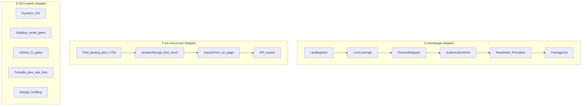

# P1 — Strongly supports the objective (shipped)

Status: **complete** (22 November 2026). Lint / typecheck / build passed after implementation.

UI preference applied during build: keep the **first three** homepage blocks (`LandingHero`, `LiveCoverage`, `ProcessDiagram`), then the conversion funnel below.

---

## Phase 1 — D: Homepage conversion focus — done

[`src/app/page.tsx`](src/app/page.tsx) composition:

**Kept, in order:**
1. `LandingHero`
2. `LiveCoverage` + ripple atmosphere (kept per UI preference)
3. `ProcessDiagram` + threads atmosphere
4. `AudienceSwitcher` (restored)
5. Newsletter + principles (`NewsletterCard` + `FeatureRows`)
6. `PackageCta`

**Removed from home** (still via nav / Learning Center):
- `PortalIndex`
- `CompareMatrix` shortlist
- “Popular Odoo pages” `LinkTiles`
- `TrustHighlights`

Orphan components (`live-coverage.tsx`, `compare-matrix.tsx`) retained for reuse.

---

## Phase 2 — F: Ad landing readiness — done

### 2a. First-touch attribution
- [`src/lib/utm.ts`](src/lib/utm.ts): `captureFirstTouch`, `withStoredUtms`, `mergeAttribution` prefers stored `landing_path`
- [`src/components/attribution-capture.tsx`](src/components/attribution-capture.tsx) in root layout
- Sticky CTA + PackageCta append stored UTMs

### 2b. Embedded consultation
- Package detail sidebar: `InquiryForm` with package / interest prefills
- Package index: `ConsultationBand`
- Industries / comparisons / landings: end-of-article band via [`src/components/doc-page.tsx`](src/components/doc-page.tsx) + [`src/components/consultation-band.tsx`](src/components/consultation-band.tsx)

### 2c. Content CTA consistency
- Garments + accounting landings and industry “Next step” blocks now include `/contact` and/or package links
- Comparisons index has `PackageCta`

### 2d. Sticky CTA desktop
- [`src/components/sticky-cta.tsx`](src/components/sticky-cta.tsx): commercial paths visible on `md+`

### 2e. Keyword map
- [`docs/AD_LANDING_KEYWORD_MAP.md`](docs/AD_LANDING_KEYWORD_MAP.md) — Odoo ads land on this domain, not binaryquest.com homepage

---

## Phase 3 — E: SEO and shareability polish — done

### 3a. Dynamic OG
- [`src/lib/og.tsx`](src/lib/og.tsx) + [`src/app/og/route.tsx`](src/app/og/route.tsx)
- Wired in doc, package, and event metadata; static `ob-og.png` remains hub fallback

### 3b. `sameAs`
- Bare YouTube key removed from [`src/lib/site.ts`](src/lib/site.ts)
- JSON-LD `sameAs` = LinkedIn + Facebook only; Binary Quest stays `parentOrganization`

### 3c. Syllabus gates
- `functional-syllabus` and `technical-syllabus` gated like ERP checklist in `doc-page.tsx`

### 3d. Anti-abuse
- [`src/lib/rate-limit.ts`](src/lib/rate-limit.ts) (Upstash when env set; in-memory fallback)
- Turnstile on inquiry form + server verify ([`src/lib/turnstile.ts`](src/lib/turnstile.ts)); skipped when secret unset
- Env documented in `.env.example`

### 3e. CI
- [`.github/workflows/ci.yml`](.github/workflows/ci.yml): `content:check` → lint → typecheck → build

### 3f. Bangla / hreflang
- `/bn` index + `/bn/[slug]` mirrors for pricing, implementation cost, accounting, garments, vs Tally
- `content/bn/*.mdx`, [`src/lib/i18n.ts`](src/lib/i18n.ts), [`src/lib/bn-content.ts`](src/lib/bn-content.ts)
- Paired `alternates.languages` + sitemap entries

---

## Production follow-ups (ops, not code)

- Set `NEXT_PUBLIC_TURNSTILE_SITE_KEY`, `TURNSTILE_SECRET_KEY`, `UPSTASH_REDIS_REST_*`
- Media buying: use [`docs/AD_LANDING_KEYWORD_MAP.md`](docs/AD_LANDING_KEYWORD_MAP.md); stop Odoo ads on binaryquest.com homepage
- Deepen Bangla copy with human review for NBR / Mushak / VAT / pricing (P0 content cadence)

**Still out of this plan (P0 / P2):** content depth cadence, production CRM webhook/ESP, analytics/Search Console, forum/recordings.
