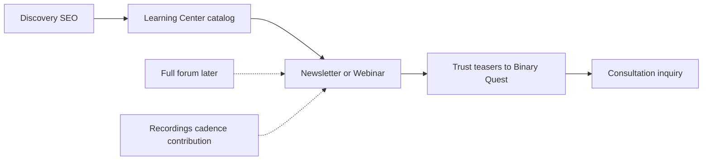

# P2 — Community Layer

**Status (22 Nov 2026):** Original implementation pass **complete**. Learning Center engagement refinement **shipped**. Objective doc **synced**. Remaining items are follow-on community depth and ops cadence—not a redo of the foundation.

## Decisions locked (unchanged)

- **Success proof:** Trust teasers + workshop/learner highlights on this site, with deep links to genuine Binary Quest URLs. No invented named case studies.
- **Q&A:** Full forum remains a **later phase**. [`/forum`](src/app/forum/page.tsx) stays a stub with “planned” copy + contact CTA.
- **Knowledge Hub brand:** [`/learning-center`](src/app/learning-center/page.tsx) is canonical; [`/knowledge-hub`](src/app/knowledge-hub/page.tsx) permanently redirects.
- **ESP double opt-in:** Still **P0 CRM/ops**. Consent fields, attribution, placement, and unsubscribe messaging are ready for ESP wiring without redesign.

---

## Current-state audit

| Feature | Status | What’s live |
|--------|--------|-------------|
| Knowledge Hub | **Shipped + refined** | Audience switcher, path CTAs, sequence, core guides, early `HubCatalog` search/filter, topic dirs, blog, trust, newsletter. Sticky CTA → training advice. |
| Resources index | **Shipped** | [`/resources`](src/app/resources/page.tsx) lists collection docs; sitemap entry present. |
| Newsletter | **Shipped (pre-ESP)** | Consent + `consentAt` + attribution; LC + events + home; [`/unsubscribe`](src/app/unsubscribe/page.tsx) (manual until ESP). Hook documented on `captureLead`. |
| Trust proof | **Shipped** | [`trust-highlights.ts`](src/lib/trust-highlights.ts) + [`TrustHighlights`](src/components/trust-highlights.tsx) on home, LC, packages. |
| Webinars/Events | **Shipped (seed data)** | Typed [`CommunityEvent`](src/lib/events.ts) (not MDX); 3 upcoming + 1 past; [`/events`](src/app/events/page.tsx) + [`/events/[slug]`](src/app/events/[slug]/page.tsx); Event JSON-LD; register → `InquiryForm` webinar interest. |
| Recordings / archive | **Not started** | Past event has `recapPath` only; no `recordingUrl`; no newsletter archive page. |
| Contribution path | **Not started** | No submit-resource / public-answer flow. |
| Forum / Q&A | **Deferred stub** | Contact-only; no accounts/moderation. |
| Webinar cadence | **Ops** | Seed dates in 2027; six consecutive months not yet an operating reality. |
| Docs sync | **Synced** | [`WEBSITE_OBJECTIVE_AND_REMAINING_WORK.md`](docs/WEBSITE_OBJECTIVE_AND_REMAINING_WORK.md) §P2 marks foundation shipped vs remaining ops (22 Nov 2026). |

---

## 1. Knowledge Hub — shipped

**Delivered**

- Unified catalog via [`HubCatalog`](src/components/hub-catalog.tsx) over `listAllDocs()` + collection filter.
- [`/resources`](src/app/resources/page.tsx) index; `/knowledge-hub` → `/learning-center`.
- Newsletter + trust on the hub; SEO canonical remains `/learning-center`.

**Engagement refinement (post-ship, completed)**

- Audience-first tabs: Business / Professional / Student / Developer.
- Intro CTAs: Start functional path + Browse all resources (`#browse-catalog`).
- Catalog moved above topic dirs; removed overlapping “Training pathways” and unranked “Popular guides.”
- Sticky CTA maps `/learning-center` (and `/knowledge-hub`) to training-advice intent ([`sticky-cta.tsx`](src/components/sticky-cta.tsx)).

**Out of scope (still):** MDX depth / publishing cadence (P0 content).

---

## 2. Trust teasers — shipped

- Curated [`src/lib/trust-highlights.ts`](src/lib/trust-highlights.ts); workshop + operator links only.
- Placed on home, Learning Center, packages.
- No invented customers or fake case studies.

---

## 3. Newsletter polish — shipped (ESP pending P0)

- Consent checkbox required; attribution + `consentAt` on lead payload.
- Placed on Learning Center and Events (and home).
- `/unsubscribe` explains manual process until ESP.
- `captureLead` comments mark ESP double-opt-in hook point.

**Gap:** `/unsubscribe` is not in [`sitemap.ts`](src/app/sitemap.ts) (optional polish when syncing docs).

---

## 4. Webinars and Events — shipped (seed)

- Expanded TS model in [`events.ts`](src/lib/events.ts): `startsAt`, `endsAt`, `location`, `status`, optional `recordingUrl` / `recapPath`, `body`.
- Detail routes + upcoming/past split + `event()` JSON-LD in [`schema.ts`](src/lib/schema.ts).
- Per-event registration via inquiry form (`defaultInterest` / message includes slug).
- Success remains “confirm by email” until CRM/notification (P0).

**Not in this pass:** MDX `content/events` collection (typed TS chosen); automated confirmation emails; real recordings.

---

## 5. Forum — still later

- Stub copy states forum is planned; contact CTA for questions.
- Do not add accounts, Discourse, or public Q&A collections until volume justifies (Discourse vs moderated `/questions` MDX).

---

## Follow-on work (P2.1 / ops)

Ordered by usefulness after the foundation:

1. ~~**Sync objective doc** — Mark shipped P2 foundation in [`WEBSITE_OBJECTIVE_AND_REMAINING_WORK.md`](docs/WEBSITE_OBJECTIVE_AND_REMAINING_WORK.md).~~
2. **Recordings / archive** — Attach real `recordingUrl`s; optional newsletter issue archive only with real content.
3. **Contribution path** — Lightweight “submit a resource / ask a question” → moderated public answer (can precede full forum).
4. **Webinar ops** — Run and publish a real monthly cadence; update past sessions honestly.
5. **P0 dependencies** — ESP double opt-in, CRM webhook notifications, analytics events for newsletter/webinar (not reopened as P2 build work).

---

## Original implementation order (done)

1. ~~Learning Center catalog + resources index + `/knowledge-hub` redirect~~
2. ~~Trust teasers data + component + placements~~
3. ~~Newsletter consent/attribution + unsubscribe + hub/events placement~~
4. ~~Events model + detail routes + Event JSON-LD + upcoming/past~~
5. ~~Forum stub deferred; objective doc synced (22 Nov 2026)~~

## Technical constraints (still binding)

- App Router + Quiet Premium; reuse `PageIntro`, `LinkTiles`, `InquiryForm`, `captureLead`, directory patterns.
- Responsive, accessible forms; honeypot; no unnecessary dependencies.
- No invented customers, stats, or case studies.
- SEO metadata + sitemap for hub/resources/events; unsubscribe sitemap optional.

## Done when (original pass) — met

- Visitors can filter/browse educational content from Learning Center.
- Trust section links only to real Binary Quest proof / honest workshop highlights.
- Newsletter captures consent + attribution; unsubscribe path is clear.
- Events show upcoming/past with schema and per-event registration into existing lead pipeline.
- Forum remains explicitly deferred.

## Done when (follow-on)

- ~~Objective doc P2 checklist matches codebase.~~
- Real recordings or explicit omission; no fake media links.
- Contribution or Q&A path exists beyond contact-only stub **or** remains consciously deferred with updated docs.
- Webinar cadence is an operating practice, not only seed dates in `events.ts`.
