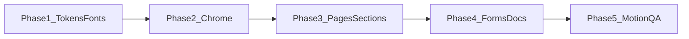

# Quiet Premium redesign (presentation only)

## Inspection summary

| Area | Current state |
|------|----------------|
| Stack | Next.js 16.2 App Router, React 19, Tailwind 4 (`@import "tailwindcss"` + `@theme inline` in [`src/app/globals.css`](src/app/globals.css)) |
| Fonts | Geist / Geist Mono via `next/font/google` in [`src/app/layout.tsx`](src/app/layout.tsx) |
| Color | Hard-coded zinc/white utilities sitewide; no design tokens |
| Motion libs | None installed (CSS-only; no new deps) |
| Content/API | Untouched — out of scope |

**Section 6 components (restyle only):**

- [`site-header.tsx`](src/components/site-header.tsx) — sticky blur; no scroll state, no underline, no mobile sheet
- [`site-footer.tsx`](src/components/site-footer.tsx) — light border footer; disclaimer present
- [`sticky-cta.tsx`](src/components/sticky-cta.tsx) — always-on mobile bar
- [`whatsapp-fab.tsx`](src/components/whatsapp-fab.tsx) — fixed emerald pill
- [`exit-intent-lead-modal.tsx`](src/components/exit-intent-lead-modal.tsx) — trigger logic stays; shell restyle + a11y shell polish
- [`inquiry-form.tsx`](src/components/inquiry-form.tsx), [`newsletter-card.tsx`](src/components/newsletter-card.tsx)
- [`seo-section-card.tsx`](src/components/seo-section-card.tsx), [`related-links.tsx`](src/components/related-links.tsx), [`package-cta.tsx`](src/components/package-cta.tsx)
- [`doc-page.tsx`](src/components/doc-page.tsx) — reading column only; no TOC / progress bar
- Home hero in [`src/app/page.tsx`](src/app/page.tsx)

**Hard rules (every phase):** same props/handlers/hrefs/validation; light theme only; no Odoo brand assets; footer disclaimer stays full opacity; tokens only (no hard-coded hex/px/ms in components); CSS motion only; `prefers-reduced-motion` + no-JS safety; no new npm packages.

## Approach

Work one phase per approval cycle. After each phase: files changed, §10 checklist, skips, and `git diff --stat` confirming no content/API/data-loader edits.

## Phase 1 — Foundation (implement first after approval)

**Files:** [`src/app/globals.css`](src/app/globals.css), [`src/app/layout.tsx`](src/app/layout.tsx)

1. Replace `:root` / `@theme inline` with §4 tokens: color (`--bg`, `--surface`, `--ink`, `--brand`, …), type scale (`--text-display`…), spacing/radius/elevation/motion, map into Tailwind via `@theme` (`--color-bg`, `--font-display`, `--shadow-1`, etc.).
2. Swap Geist → `Bricolage_Grotesque` (display, CSS var) + `Hind_Siliguri` (body, Latin+Bengali, weights 400/500/600) via `next/font/google` (`display: "swap"`). Fallback stack in CSS: Hind Siliguri → Noto Sans Bengali → system-ui.
3. Global base: `body` on `--bg`/`--ink`, heading letter-spacing, focus-visible ring (`--focus`), container utility (`max-width: 1200px`), scroll-padding for sticky chrome.
4. Add mandatory `prefers-reduced-motion` block and a tiny inline script or class convention for `.js` on `<html>` so later reveals stay visible without JS.
5. Do **not** restyle components yet (layout body classes may switch to token utilities only).

## Phase 2 — Chrome

**Files:** header, footer, sticky-cta, whatsapp-fab, exit-intent-modal (+ minimal client helpers if needed for scroll class / focus trap presentation).

- Header: glass, 72/60 height, scroll >8px shadow, nav underline, mobile full-height sheet (same `nav` links; add sheet because desktop-only nav currently leaves mobile without nav — presentation completion of existing chrome, not new routes).
- Footer: `--brand-deep` band, mint/white links, disclaimer ≥0.875rem full opacity.
- Sticky CTA: glass + `--shadow-3`; show after hero scroll, hide near footer / keyboard; safe-area.
- WhatsApp FAB: 56px circle, one pulse on first reveal, expand label on hover; keep `siteConfig.social.whatsapp`.
- Exit modal: backdrop blur, scale enter/exit, Esc + focus trap + focus return; same dismiss storage key and links.

## Phase 3 — Pages and sections

**Files:** [`page.tsx`](src/app/page.tsx) (layout/classes only), seo-section-card, related-links, package-cta, shared button/card utility classes in CSS.

- Hero: display type, optional ≤5% dot grid, one load sequence (mask-reveal → support → CTAs).
- Section rhythm + asymmetric/bento for existing SEO cards (same five cards/order).
- Card hierarchy (feature / standard / link row); Package CTA deep-green band with inverted primary.

## Phase 4 — Forms and docs

- Inquiry + newsletter shells: sunken band, 48px inputs, brand focus halo, accent error styling, success check draw — validation/API untouched.
- Doc chrome: 720px column, sticky TOC (≥lg) with active indicator, 2px reading progress, prose/code/callout token styles. TOC derived from existing rendered headings only (no content edits).

## Phase 5 — Motion polish and QA

- Restrained scroll reveal (≤1 group/section), existing-stat count-up only if numeric stats already exist, optional View Transitions crossfade.
- Run `lint`, `typecheck`, `build`, `content:check`; report §10 + responsive/keyboard; fix presentation regressions only.

## Explicit non-goals

No edits to `content/**`, `src/lib/content.ts`, API routes, `siteConfig` values, copy strings, or CTA destinations. No Motion/GSAP. No dark mode / theme toggle.