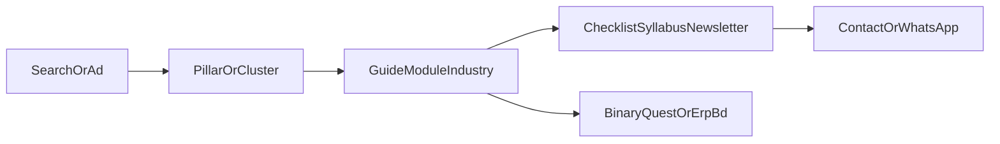

# Odoo Bangladesh branding guideline

Last revised: 2026-11-16

This is the brand bible for **odoobangladesh.com**. Use it for UI, marketing copy, SEO titles, ads landing pages, and agent-authored content.

| Doc | Role |
|-----|------|
| [`PROJECT_BLUEPRINT.md`](./PROJECT_BLUEPRINT.md) | Product goals, architecture, roadmap |
| [`CONTENT_GUIDE.md`](./CONTENT_GUIDE.md) | MDX writer rules (word counts, frontmatter, linking) |
| **This file** | How the brand looks, speaks, ranks, and keeps people on-site |

Writer mechanics (em dashes, minima, `related:` checks) stay in the content guide. Do not duplicate those tables here; follow them when drafting MDX.

---

## 1. Brand essence

### Positioning

**Brand name:** Odoo Bangladesh  
**Domain:** odoobangladesh.com  
**Operator:** Binary Quest Limited (disclosed on About, footer, and schema)

**Positioning statement** (from `src/lib/site.ts`):

> Bangladesh’s independent Odoo ERP learning and demand portal: implementation guides, industry pages, training, packages, and consultation paths that connect qualified interest to Binary Quest.

**Promise:** Bangladesh-specific guidance that helps learners and buyers decide, then request a consultation when ready.

**Personality:** Trusted local educator. Practical. Low-pressure. Specific over clever. Never agency-slick, never official-Odoo corporate.

### What this brand is / is not

| Is | Is not |
|----|--------|
| Independent community-style learning hub | Affiliated with Odoo S.A. |
| SEO and demand portal for Odoo in Bangladesh | Binary Quest’s corporate website |
| Educational first, commercial handoff second | Broad “what is ERP” education (that is ERP Bangladesh) |
| Soft path to packages, training, and consultation | Hard sell or “hire us / we implement” agency pitch |

### Primary audiences

1. **SME and enterprise buyers** researching Odoo pricing, implementation, and industry fit in Bangladesh
2. **Functional and technical learners** building careers or company capability
3. **Industry operators** (garments, distribution, manufacturing, retail, and related sectors)

### Sister-site routing (brand routing rules)

Route by intent, not by which company owns the domain:

| Visitor intent | Send them to |
|----------------|--------------|
| Pre-Odoo ERP curiosity (“what is ERP?”) | [erpbangladesh.com](https://erpbangladesh.com/) |
| Odoo learning, packages, training, keyword landings | **odoobangladesh.com** (this brand) |
| Company proof, careers, full case studies | [binaryquest.com](https://www.binaryquest.com/) |

### Legal and trademark constraints (binding)

- **Light theme only.** No dark mode, no theme toggle.
- **No official Odoo brand assets.** No Odoo logo, wordmark, or product UI imitation.
- **"Odoo" in copy** is fine as the product name; always pair the site identity with “Odoo Bangladesh” or “community portal.”
- **Footer disclaimer** on every page: not affiliated with Odoo S.A. (see `site-footer.tsx`).
- **Lead source tag:** `odoobangladesh.com` (required for practice CRM attribution).

---

## 2. Visual identity

Source of truth for tokens: `src/app/globals.css` (Educeet-derived palette). Theme wiring: `src/app/layout.tsx`.

### Colour

| Token | Hex | Use |
|-------|-----|-----|
| Brand green / strip | `#0b5a49` | Hero bands, top strip, primary buttons, stats/CTA strips |
| Brand deep | `#0f6b57` | Depth / hover |
| Brand yellow | `#f6b920` | Accent underline, convert CTAs (`.edu-btn.y`) |
| Ink / foreground | `#17302a` | Body text, yellow-button text |
| Soft / background | `#edf4f1` | Page background |
| Muted | `#6b7f78` | Supporting copy |
| Card | `#ffffff` | Surfaces |
| Border | `#d7e3de` | Card edges, tags, dividers |
| Hero subcopy | `#bcd8cf` | Supporting text on green hero only |

Category tile pastels (`edu-c1`…`edu-c8`) are secondary navigation colour only. Do not invent new accent hues for marketing creatives without updating the CSS tokens.

### Typography

**Stack**

- **UI and marketing:** Poppins (`--font-poppins`) → Geist Sans → system-ui, sans-serif  
- **Code / technical snippets:** Geist Mono

**Live scale (homepage / Educeet shell)**

| Role | Approx size | Weight | Notes |
|------|-------------|--------|-------|
| Hero H1 | 44px | 600 | Line-height ~1.2; yellow underline on key phrase via `<u>` |
| Section H2 (`.edu-h2`) | 28px | 600 | Yellow underline accent on emphasized words |
| Card / pathway titles | 19–26px | 600 | Keep short |
| Body (site default) | 14px | 400 | Line-height 1.6 |
| Buttons | 11–13px | 500 | Compact; prefer clarity over size |
| Tags / chips / meta | 10–12px | 400–500 | Muted or green |

**Reading comfort for dwell**

- Prefer short paragraphs and scannable `##` headings on long guides.
- Max content width for long-form: keep prose readable (existing doc layouts ~`max-w-3xl` / homepage wrap ~1140px).
- Do not switch to Inter, Roboto, Arial, or serif display faces for brand pages.
- Do not introduce a second display font without a deliberate redesign.

### Accent and motion

- Yellow underline on key brand or section phrases (hero and H2) is the signature accent.
- Motion should reinforce hierarchy (gentle reveal, sticky consult), not decorate every card.
- Prefer 2–3 intentional motions sitewide over continuous animation noise.

### Buttons and CTA hierarchy

| Style | Look | When to use |
|-------|------|-------------|
| Primary green (`.edu-btn`) | `#0b5a49` fill, white text | Default navigation actions (“View packages”, explore hubs) |
| Convert yellow (`.edu-btn.y`) | `#f6b920` fill, ink text | Highest-intent actions (“Request ERP consultation”) |
| Ghost (`.edu-btn-ghost`) | Translucent / bordered on green | Secondary action beside a yellow convert CTA |

One primary convert action per viewport or page section. Do not place two yellow CTAs competing in the same band.

### Imagery

- Show Bangladesh context, people learning/working, or real operational atmosphere (factory floor, warehouse, office) when possible.
- Hero should keep **Odoo Bangladesh** as a hero-level brand signal (name in H1 or dominant lockup), not only in the nav.
- Do not use official Odoo product screenshots that imply affiliation.
- Do not paste Odoo S.A. logos into creatives or Open Graph images.
- Decorative gradients alone are not the main visual idea; pair with real subject matter when assets exist.

### Consistency debt (chrome)

Primary LMS leftovers in header, footer CTA, homepage bottom CTA, and training pathway labels were aligned to approved CTA language. Keep avoiding course/LMS framing when adding new UI:

| Avoid | Prefer |
|-------|--------|
| “Apply Now” | “Request consultation” or “Request ERP consultation” |
| “Search Courses…” | “Search guides…” or “Learning center” |
| “Start Learning Now” on consult CTAs | “Request ERP consultation” |
| Course / LMS framing for packages | “Packages” / practice offer language |

---

## 3. Voice and messaging

Authoritative detail for MDX: [`CONTENT_GUIDE.md`](./CONTENT_GUIDE.md). Brand-level rules below.

### Voice attributes

- Plain English, confident, specific  
- Prefer “you” and “your team”  
- Bangladesh first (BDT, NBR VAT / Mushak, local payroll, bKash/Nagad/Rocket, garments/BGMEA context where relevant)  
- British or Bangladeshi English spellings consistently within a page (organisation, customisation, localisation)  
- Educational first; commercial follow-up is optional and clearly labelled

### Message pillars (in order)

1. **Learn** — guides, modules, industries, training pathways
2. **Compare** — Odoo vs alternatives with a clear verdict for Bangladesh
3. **Package clarity** — Starter → Enterprise and Care Plan overviews without public discount lists
4. **Consult** — request a consultation with Binary Quest when the visitor is ready

### Approved CTA language

Use these (or close variants):

- Request ERP consultation  
- Request a consultation  
- Talk to a specialist  
- View packages  
- Get the checklist  
- Subscribe (newsletter)  
- Start with the syllabus  
- Talk to Binary Quest about [Package name]

### Banned or avoid

- “We implement”, “hire us”, “our agency will…”  
- Implying affiliation with Odoo S.A.  
- Em dashes (`—`) and `--` used as dashes (content guide hard rule)  
- Exclamation marks in body marketing copy  
- Fluff openers (“In today’s fast-paced world…”)  
- Empty intensifiers: “genuinely”, “honestly”, “seamless”, “robust”, “leverage”  
- Invented customers, rankings, partner counts, or case studies  
- Invented Bangladesh list prices for Odoo licences

Default byline for community content: **Odoo Bangladesh Community**.

---

## 4. SEO brand rules

Goal: topical authority for Bangladesh Odoo queries, then qualified time-on-site and leads (see blueprint G1–G3).

### Titles and metadata

- Pattern: `%s | Odoo Bangladesh` (`src/app/layout.tsx`)  
- Default site name and description from `siteConfig`  
- Page titles ~50–65 characters; include primary keyword and “Bangladesh” where natural  
- Meta descriptions ~140–160 characters; answer the query directly, no fluff  
- Canonical per page; landings use the short keyword slug as canonical (see blueprint URL model)  
- Open Graph / Twitter: honest title + description; prefer a real preview image when assets exist (no fake Odoo-branded creatives)

### Keyword and silo behaviour

- Pair product + local intent: e.g. “Odoo accounting Bangladesh”, “Odoo for garments”, “Odoo vs ERPNext”  
- Pillars: learning center, implementation guide, pricing guide, career guide, training  
- Clusters: modules, industries, comparisons, packages, blog, events, resources  
- First ~100 words of a content page must answer the search intent  
- FAQ blocks + JSON-LD (`FAQPage`, `Article`/`BlogPosting`, `Course`, `BreadcrumbList` as implemented) support rich results and dwell

### Internal linking (dwell + SEO)

- Every substantive page ends with related links and one funnel-matched “Next step”  
- `related:` frontmatter rules in the content guide are brand requirements, not optional polish  
- Always keep soft paths to packages, Care Plan, and consultation where commercially relevant

### Ads and attribution

- Paid Odoo-keyword traffic should land on industry or package pages on this domain, not a generic homepage-only experience when a tighter page exists  
- Forms capture UTM + path (`src/lib/utm.ts`); preserve attribution into inquiry and newsletter submissions  
- Lead source remains `odoobangladesh.com`

---

## 5. Dwell-time and engagement system

People stay when each screen does one job, answers the query, and offers a clear next page.

### Content behaviours that increase time on site

- One job per section; one headline; one short supporting sentence  
- Scannable H2s; tables for comparisons; checklists for implementation  
- Depth over doorway pages (follow content guide word minima)  
- Dense internal links so finishing a page naturally opens the next useful page  
- Bangladesh specifics readers cannot get from generic global docs

### Funnel-matched single primary CTA

| Page type | Primary “Next step” |
|-----------|---------------------|
| Modules, industries | ERP readiness checklist (`/resources/erp-checklist`) |
| Comparisons, pricing / cost landings | Talk to a specialist (`/contact`) |
| Training topics | Syllabus + training hub |
| Blog / insights | Newsletter (and learning center) |
| Resources | Contact / consultation |

### Homepage journey (keep in this order of intent)

Pathways → proof/stats or about → packages → training pathways → blog → newsletter → popular pages + sister domains → bottom consult CTA.

### Conversion chrome (global shell)

Already mounted in `layout.tsx`. Brand rules for use:

| Element | Brand behaviour |
|---------|-----------------|
| Newsletter | Educational nurture + soft consult invite |
| Sticky CTA (mobile) | Consult path; short copy; yellow convert |
| Exit-intent modal | Checklist lead magnet; once per session; educational framing |
| WhatsApp FAB | Desktop; Binary Quest WhatsApp; optional live help |
| Inquiry form | Interests + UTM; honeypot; no invented urgency |

Do not stack multiple interruptive modals. Soft chrome must not fight the reading experience.

### Visitor journey

---

## 6. Page-type brand recipes

### Home

- Brand name as hero-level signal with one H1, one supporting sentence, one CTA group, one dominant image  
- Disclose operator + non-affiliation near the hero  
- Primary convert: consultation; secondary: packages  
- Then pathway grid into hubs that extend the session

### Pillars (guides, learning center, pricing, career, implementation)

- Direct answer up top  
- Bangladesh-specific sections  
- Links into clusters (modules / industries / training)  
- One mid- or bottom-funnel CTA only

### Clusters (modules, industries, comparisons)

- Verdict or definition first  
- Localisation and cost assumptions where relevant  
- Related links that cross silos  
- CTA per funnel table in section 5

### Packages

- Clear scope language; no public discount lists  
- Quotes after discovery  
- CTA: “Talk to Binary Quest about [tier]” into contact with package context

### Training

- Outcomes, prerequisites, syllabus path  
- Company training can become a sales path when budget exists; keep educational tone  
- Link career guide and syllabi resources

### Blog and events

- Insights and date-intent sessions  
- Newsletter as default soft convert  
- No invented attendance or ranking claims

### Contact / About

- About: operator disclosure, three-domain map, trust  
- Contact: consultation request; explain attribution; learner vs buyer interests without pressure

---

## 7. Do / don’t checklist

Use before shipping UI, ads, or content.

### Do

- [ ] Say **Odoo Bangladesh** as the site brand; disclose Binary Quest as operator where trust requires it  
- [ ] Keep light theme and green / yellow / soft palette tokens  
- [ ] Use Poppins-first typography and yellow underline accent sparingly on key phrases  
- [ ] Write Bangladesh-first, query-answering copy in the first screen of content  
- [ ] Use one primary CTA matched to funnel stage  
- [ ] Add related links that open a sensible next page  
- [ ] Keep footer non-affiliation disclaimer  
- [ ] Route pre-Odoo and corporate-proof intent to sister sites  

### Don’t

- [ ] Use Odoo S.A. logos or imitate official product chrome  
- [ ] Hard-sell (“we implement”, “hire us”) on this domain  
- [ ] Invent case studies, prices, or rankings  
- [ ] Ship LMS leftover labels (“Apply Now”, “Search Courses…”) on new work  
- [ ] Place competing yellow CTAs or interruptive modals on the same view  
- [ ] Add dark mode or a second unrelated colour system  
- [ ] Send early-stage “what is ERP?” traffic only to packages; use ERP Bangladesh when appropriate  

---

## Contact and social (brand facts)

From `src/lib/site.ts` (update this section if site config changes):

- Portal email: hello@odoobangladesh.com  
- Operator: Binary Quest Limited — info@binaryquest.com — +880 2 9350383  
- WhatsApp: wa.me/8801937091332  
- Address: 245/2 New Circular Road, Malibagh, Dhaka, Bangladesh  
- Social: Binary Quest LinkedIn and Facebook; YouTube as configured in site config

---

## Related files

- `src/lib/site.ts` — name, description, operator, sister sites, social  
- `src/app/globals.css` — colour tokens and Educeet component styles  
- `src/app/layout.tsx` — fonts, metadata template, global chrome  
- `src/app/about/page.tsx` — operator and domain-map copy  
- `src/components/site-header.tsx` / `site-footer.tsx` — chrome and disclaimer  
- `docs/CONTENT_GUIDE.md` — MDX voice, structure, linking enforcement  
- `docs/PROJECT_BLUEPRINT.md` — goals and product constraints
